# Desktop and mobile screenshot gallery

Captured from the live public Vowstyle demo. These are screenshots of the running interface, not generated mockups.

- Desktop layout: approximately 1,180–1,212 CSS px wide.
- Mobile layout: 500 CSS px wide at native browser zoom. This verifies the responsive layout, not a physical iPhone or Android device.
- Full-page images include the entire scrollable document. Dialogs are captured at multiple scroll positions because they scroll independently.
- Both site pages are included: the main matching page and the founder's MVP/pretotype handbook. The remaining images show matching steps and dialog states on the main page.
- Vendors, prices and packages remain fictional demo data.

[Download the complete screenshot set](vowstyle-desktop-mobile.zip)

| View | Desktop | Mobile |
| --- | --- | --- |
| Full homepage / choose service | [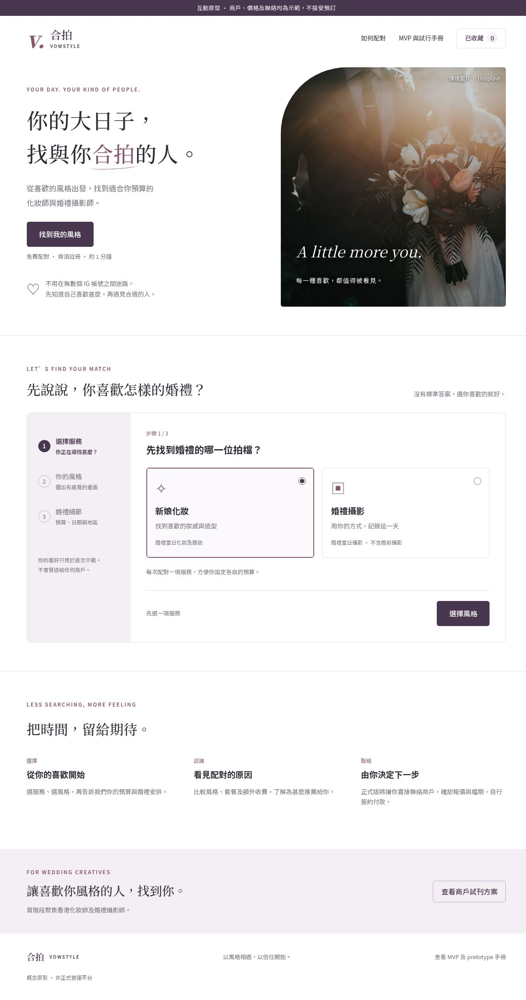](desktop-home.jpg) | [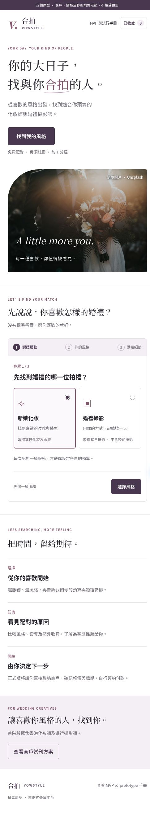](mobile-home.jpg) |
| Style selection | [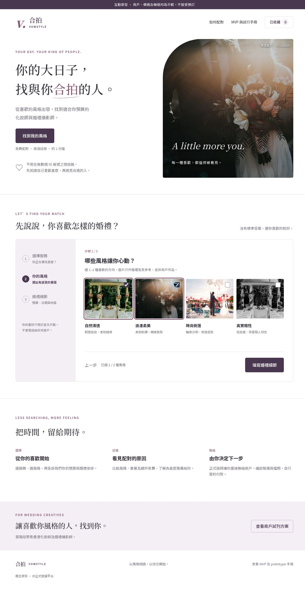](desktop-style.jpg) | [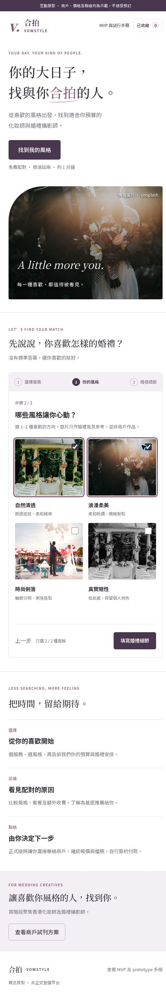](mobile-style.jpg) |
| Wedding details | [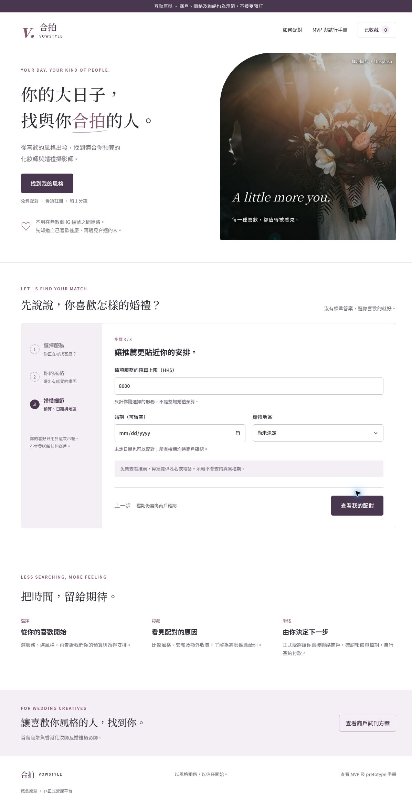](desktop-details.jpg) | [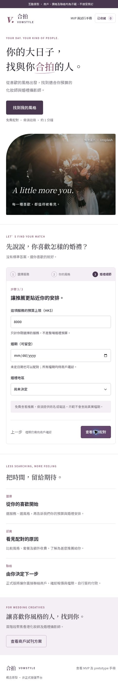](mobile-details.jpg) |
| Matching results | [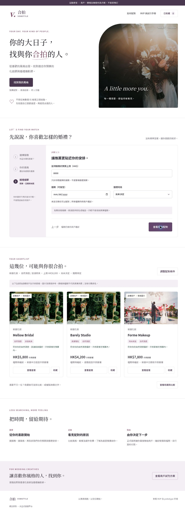](desktop-results.jpg) | [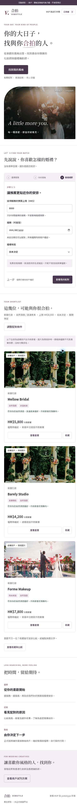](mobile-results.jpg) |
| Package overview | [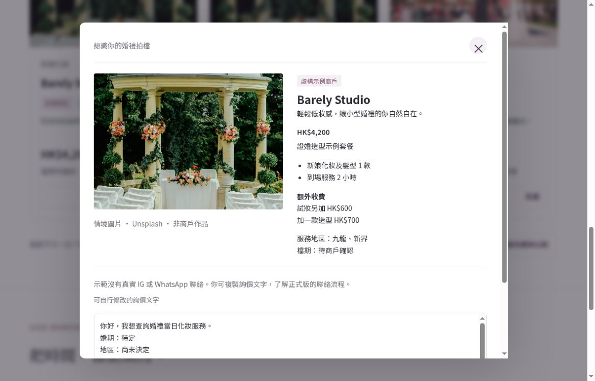](desktop-package.jpg) | [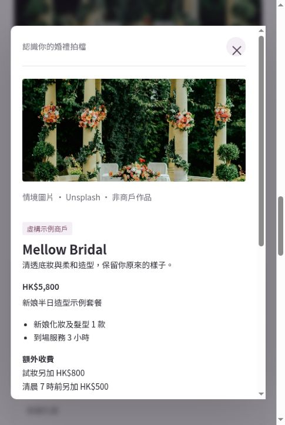](mobile-package.jpg) |
| Package and inquiry, lower section | [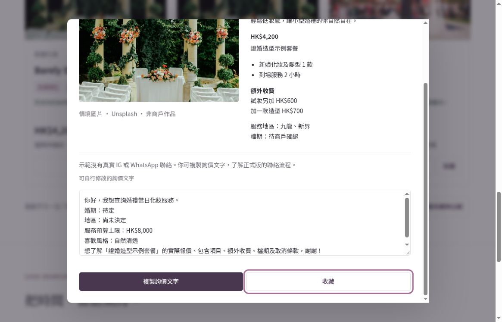](desktop-package-lower.jpg) | [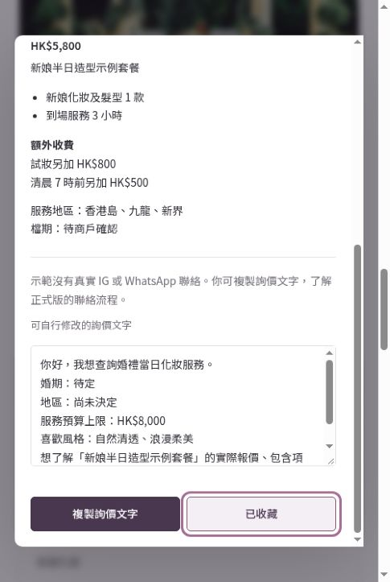](mobile-package-lower.jpg) |
| Saved vendor comparison | [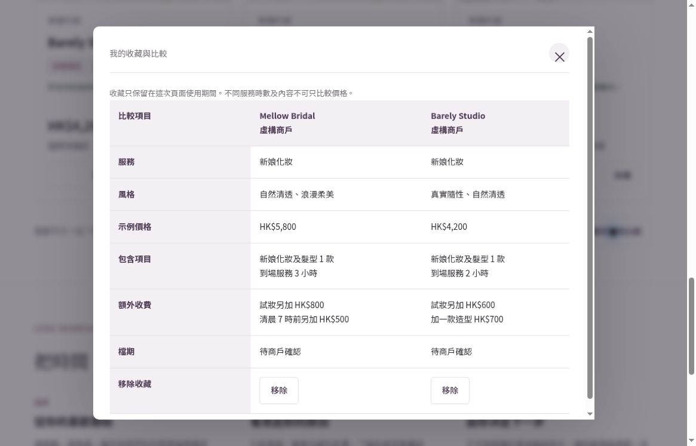](desktop-comparison.jpg) | [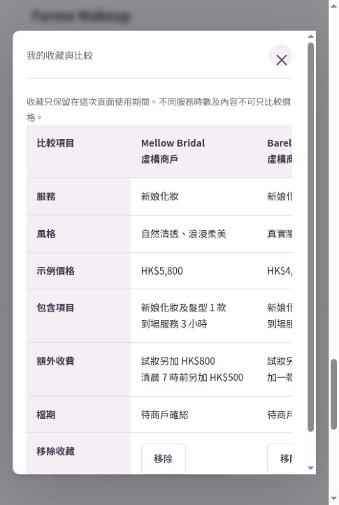](mobile-comparison.jpg) |
| No matching vendors | [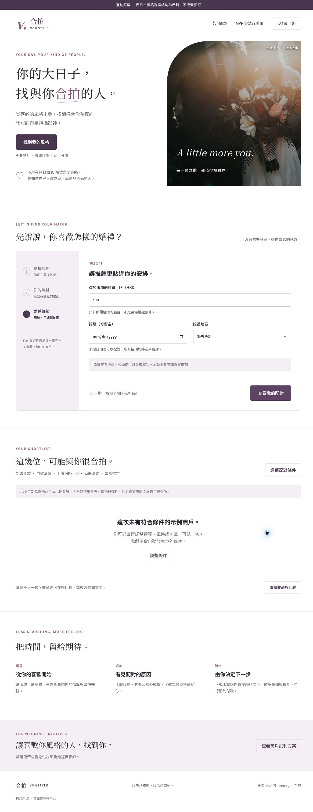](desktop-empty-results.jpg) | [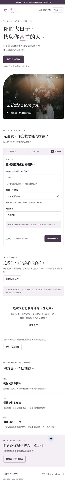](mobile-empty-results.jpg) |
| Full MVP/pretotype handbook | [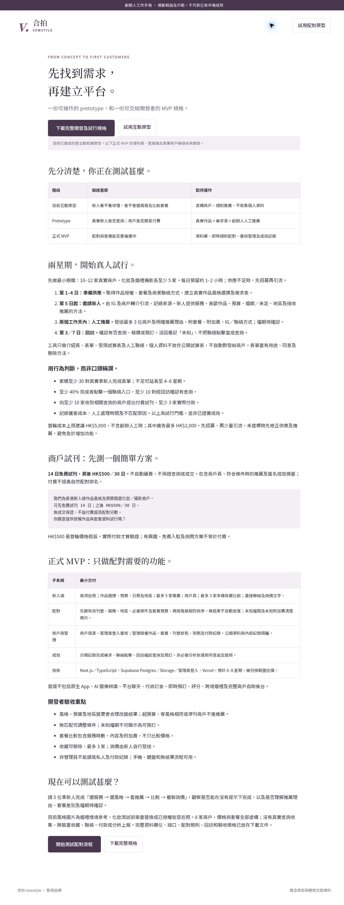](desktop-handbook.jpg) | [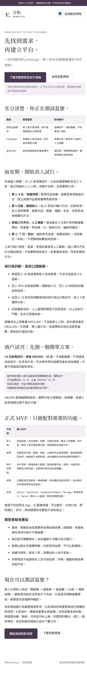](mobile-handbook.jpg) |

Additional mobile dialog captures: [package middle](mobile-package-middle.jpg), [comparison scrolled right](mobile-comparison-right.jpg), [comparison lower section](mobile-comparison-lower.jpg).

## Review notes

The comparison table intentionally scrolls horizontally on narrow screens. The screenshots include its left and right portions. Package details also require vertical scrolling; the overview, middle and lower captures cover the content.

The main flow, style selection, budget filtering, opening packages, favorites, comparison and no-match recovery were exercised through the browser. This is a focused visual review, not a complete accessibility, cross-browser or physical-device certification.
